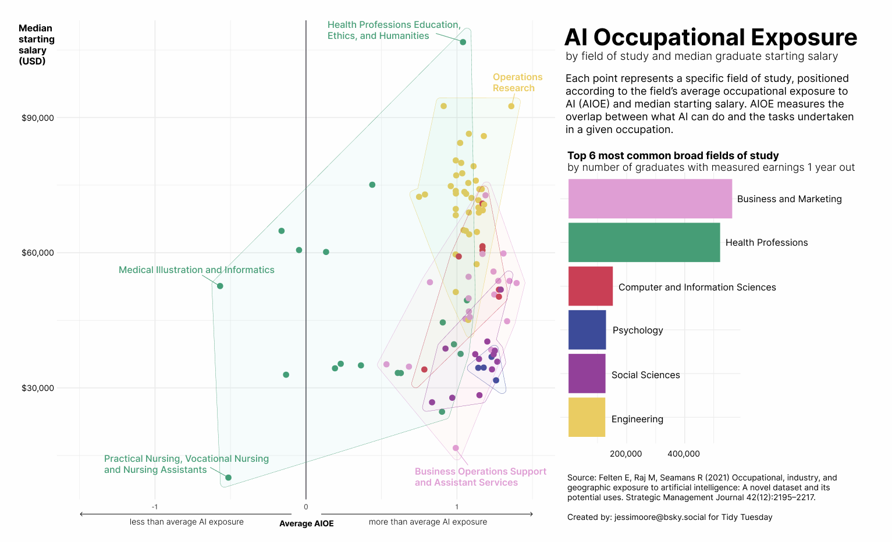

```{r}
#| code-fold: true
#| code-summary: Code

library(tidyverse)
library(paletteer)
library(ggforce)
library(scales)

tuesdata <- tidytuesdayR::tt_load(2026, week = 42)

ai_salary_majors <- tuesdata$ai_salary_majors

#fields by number of graduates
fields_df <- ai_salary_majors %>%
  group_by(broad_field) %>%
  summarise(total_n_grads = sum(n_graduates, na.rm = TRUE)) %>%
  slice_max(total_n_grads, n = 6)


#plotting
scatter <- ggplot(ai_salary_majors %>% 
              filter(broad_field %in% fields_df$broad_field),
            aes(ai_exposure, median_starting_salary, color = broad_field)) +
  geom_point(size = 4) +
  xlim(-1.5, 1.5) +
  geom_mark_hull(aes(fill = broad_field),
                 concavity = 5,
                 alpha = 0.03,
                 size = 0.2) +
  scale_color_paletteer_d("MetBrewer::Klimt") +
  labs(x = "AI exposure",
       y = "Median starting salary")  +
  scale_y_continuous(labels = label_dollar())+
  theme_minimal(base_size = 16) +
  theme(legend.position = "none")
  
legend <- ggplot(fields_df,
                 aes(total_n_grads,
                     fct_reorder(broad_field, total_n_grads),
                     fill = broad_field)) +
  geom_bar(stat = "identity") +
  scale_fill_paletteer_d("MetBrewer::Klimt") +
  scale_x_continuous(labels = label_comma()) +
  labs(x = "Total graduates",
       y = NULL) +
  theme_minimal(base_size = 16) +
  theme(legend.position = "none")

#finish assembling using Figma

```
